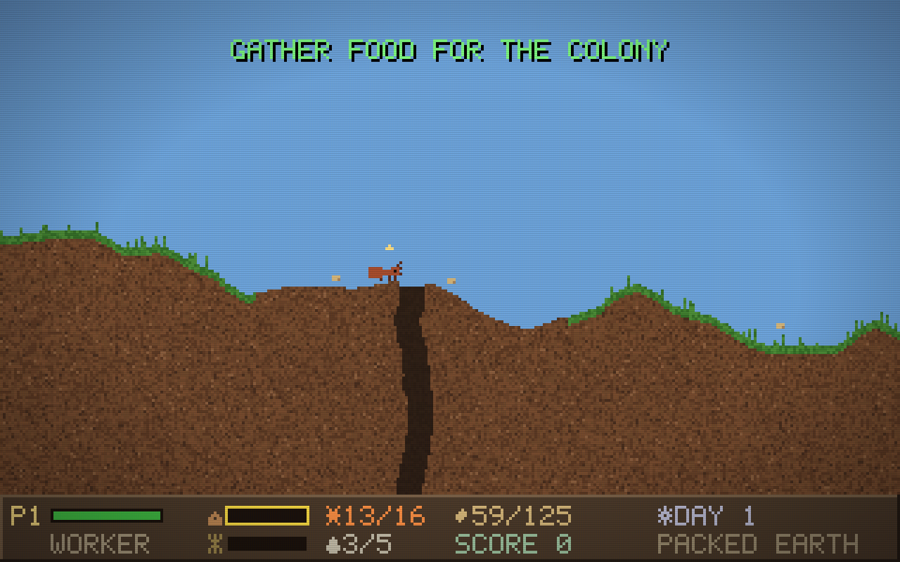

# MAUR

*An ant colony under your command.*

A Liero-style destructible-terrain game with a 1998 MS-DOS soul. You are one
ant in a living colony: dig tunnels, forage the forest floor, climb trees,
milk aphids, feed the brood, and drive off the things that bite. As long as
a single ant survives, the colony — and you — live on.



## Run it

No build, no dependencies. Open `index.html` in any modern browser:

```sh
open index.html          # macOS
# or serve it:
python3 -m http.server   # then http://localhost:8000
```

## How to play

|             | Player 1 | Player 2 |
|-------------|----------|----------|
| Move / climb | `W A S D` | Arrow keys |
| Bite / dig   | `Space`   | `.` |
| Pick up / use | `E`      | `,` |

- **Hold up against a wall (or tree) to climb.** Ants climb everything.
  Hold up under a roof to hang and crawl upside-down — tunnel ceilings and
  tree branches alike.
- **Bite** digs dirt, grass and leaves; rock and wood don't yield. The same
  bite wounds spiders, centipedes, pillbugs, worms... and prey becomes food.
- **`E` / `,`** picks up items, deposits food at the storage chamber, feeds
  hungry larvae, and milks aphids for honeydew.
- `M` map · `Esc`/`P` pause · `N` sound · `C` CRT filter

### The colony

The colony eats from the food stored in the **storage chamber**. The queen
lays eggs when stores are full; nurses ferry morsels to hungry larvae;
foragers gather seeds on the surface; soldiers patrol and fight. Follow the
**tasks** in the top-left corner — gathering, feeding, expanding the nest,
defending — to earn colony points.

If your ant dies, you continue as any other ant in the colony — worker,
soldier, nurse, even the queen. When the last ant falls, the colony is gone.

### Worlds

Three save slots, each a procedurally generated world: rolling forest floor,
trees with aphid herds in the canopy, rock seams and natural caves below,
and the colony mound with its chambers dug beneath. Your nest sits in the
left quarter of the map; a **rival red-ant colony** holds the right quarter,
its mound garrisoned by defenders, with a long stretch of open forest beyond
each nest to explore. Worlds save automatically
(and on quit) — sink hours into one and come back later. `T` on the world
select screen starts split-screen two-player; both ants serve the same colony.

### Wildlife

| Creature | Disposition |
|----------|-------------|
| Aphid | Milkable; drips honeydew near trees |
| Pillbug | Harmless; curls into a ball when bitten |
| Worm | Tunnels below; slow, nutritious |
| Spider | Surface predator, prowls at night |
| Centipede | Deep predator; follows you down tunnels |
| Wasp | Day-flying striker; dives on ants in the open |
| Beetle | Rare armored bruiser; bulldozes toward the mound |
| Red ants | Rival colony on the far side; defenders garrison their mound, raiders march on yours |

## Development

Plain JavaScript on a 320×200 canvas, integer-scaled, with a hand-built 5×7
bitmap font and WebAudio square-wave sound. No frameworks.

```
js/worldgen.js   seeded procedural generation (terrain, nest, trees)
js/terrain.js    per-pixel destructible terrain + render canvases
js/entities.js   ants (player + AI), brood, bugs, items, physics
js/colony.js     colony simulation: food, brood cycle, tasks, spawning
js/save.js       localStorage saves, RLE-packed terrain
js/main.js       game states, input, split-screen rendering, HUD
js/font.js       bitmap font · js/sfx.js WebAudio bleeps
```

Headless tests (require `npm install` for Playwright):

```sh
node test/smoke.js     # boot, play, dig, climb, save/load, 2P, takeover
node test/longsim.js   # fast-forward 3 in-game days of colony simulation
```

© 1998 BENSOFT INTERACTIVE (in spirit)
